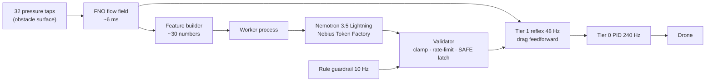

# AeroAgent

**Sparse sensors → neural flow field in milliseconds → a Nemotron-supervised drone that rides the gust.**


▶ **Demo video:** [`docs/media/aeroagent_demo.mp4`](docs/media/aeroagent_demo.mp4) · 3-min submission video: <!-- TODO: YouTube link -->

Built solo for the **Nebius × NVIDIA Global AI Hackathon, Physical AI track**.

---

## The problem

Small drones increasingly fly where the air is worst: next to buildings, bridges, wind turbines and ships. Gusts and wake vortices push them off course, and a drone usually notices only *after* its IMU registers the push. A CFD solve could tell it what is coming, but takes minutes. A drone has milliseconds.

## The idea

Give the drone a real-time picture of the air around it, and split the work by speed:

| Tier | Rate | What runs | Job |
|---|---|---|---|
| **0 · Attitude** | 240 Hz | PID + motor mixer (`DSLPIDControl`) | keep the vehicle upright |
| **1 · Reflex** | 48 Hz | 32 pressure sensors → **Fourier Neural Operator** → wind at the drone → drag feedforward | lean into the gust *before* it pushes |
| **2 · Judgment** | ~2 Hz, async | **NVIDIA Nemotron** on **Nebius Token Factory** → validated JSON intent | decide *how* to fly it, and say why |

The language model never touches the motors and never sits in a fast loop. It proposes a bounded intent (mode, gain scale, tilt limit, set-point offset); a deterministic validator clamps, rate-limits and, if the model is late or wrong, falls back to a safe hold.



## Sponsor technology used

| Component | Where | Status | Why |
|---|---|---|---|
| **NVIDIA Nemotron 3.5 Lightning** via **Nebius Token Factory** | [`agent/supervisor.py`](agent/supervisor.py) | ✅ running in the closed loop | Tier 2 supervisor, strict JSON schema, reasoning off, p50 0.56–0.70 s |
| **NVIDIA Nemotron 3 Super** via Token Factory | `agent/supervisor.py` (`--model`) | ✅ benchmarked, fallback | same role; latency varied 1.1 s → 11 s over the day (see below) |
| **NVIDIA Nemotron 3 Ultra** via Token Factory | `tools/tf_check.py` | ✅ benchmarked (reasoning on, 3/3 valid, ~5.7 s) | pre-flight mission planning <!-- TODO: wire into mission briefing --> |
| **Nebius Serverless Endpoint** | `serve/` | 🚧 Thursday | host the FNO next to the Token Factory region |
| **Nebius Serverless Jobs** | `jobs/` | 🚧 Thursday | Lattice-Boltzmann data generation + FNO training |

The FNO is implemented in plain PyTorch ([`model/fno.py`](model/fno.py)); NVIDIA PhysicsNeMo's FNO is wired in as a drop-in (`--arch physicsnemo`) but not yet benchmarked.

---

## Results

All numbers are measured, in simulation, on LBM runs the model never saw during training. Hardware: Apple M1 Max (MPS). Every figure is regenerated by `python -m viz.make_figures`.

### 1 · The FNO sees the air


| Metric (4 held-out runs) | Value |
|---|---|
| relative L2 error u / v / p | 0.067 / 0.343 / 0.201 |
| model size | 6.3 M parameters, 64 × 128 grid |
| inference, batch 1 | p50 5.9 ms · p95 7.3 ms (M1 Max) |
| training data | 37 self-generated runs, 10,841 samples |

`u` contains the mean inflow and is easy; `v` is almost pure vortex motion and is the honest number. Error rises during gusts (see `docs/figures/error_over_time.png`).

### 2 · The reflex works: −77 % to −87 % hover error

Hover 1.2 m behind the obstacle, in the wake. Same seed, same ground-truth wind for every controller.


| Held-out run | PID only (RMS / gust) | **AeroAgent (RMS / gust)** | Reduction | Perfect wind knowledge |
|---|---|---|---|---|
| run_019 | 3.2 / 3.3 cm | **0.4 / 0.3 cm** | **−87 %** | −91 % |
| run_020 | 3.1 / 4.3 cm | **0.7 / 0.7 cm** | **−79 %** | −84 % |
| run_039 | 3.3 / 3.8 cm | **0.8 / 0.4 cm** | **−77 %** | −87 % |
| run_040 | 3.5 / 3.7 cm | **0.5 / 0.3 cm** | **−86 %** | −90 % |
| **mean** | 3.3 cm | **0.6 cm** | **−82 %** | −88 % |

Wind estimate at the drone: 0.30–0.41 m/s RMS error against 1.2–1.4 m/s RMS wind fluctuation.


**Honest control experiment.** A feedforward with the *exact* time-averaged wind (an idealised anemometer, no FNO) already removes 60–76 % of the error. The FNO's added value is in the gust: during the gust it cuts the remaining error by a further 57–79 % (run_019: 1.06 → 0.46 cm, run_020: 1.89 → 0.39 cm, model v1).

### 3 · Robust to the things that will be wrong in reality


| Perturbation (run_020) | Error reduction vs. PID |
|---|---|
| nominal | −79 % |
| drag model wrong by ±30 % | −65 % / −62 % |
| drag model wrong by ±50 % | −47 % / −45 % |
| sensor noise 5 / 10 / 20 % | −79 / −80 / −80 % |
| sensor → estimate delay 25 / 50 / 100 ms | −78 / −76 / −73 % |
| other held-out run (run_019) | −87 % |

### 4 · Each component sits in the loop it is fast enough for


| Nemotron model (Token Factory, strict JSON schema) | p50 | p95 | valid | role |
|---|---|---|---|---|
| Nemotron 3.5 Lightning (eu-north1) | 0.63 s* | 0.81 s* | 25/25 | **supervisor** |
| Nemotron 3 Super (us-central1) | 1.13 s (17:20) · 11.2 s (22:38) | 1.63 s · 16.5 s | 25/25 | fallback |
| Nemotron 3 Nano | 1.32 s | 3.07 s | 25/25 | not used |
| Nemotron 3 Ultra, reasoning on | 5.72 s | 5.93 s | 3/3 | mission planning |

\* measured at 22:38; at 17:20 Lightning measured p50 1.19 s. Same model, same prompt, latency varied ~10× over one day, which is exactly why the LLM must never be in the fast loop.

### 5 · Nemotron in the real-time closed loop

The simulation is paced to wall-clock time, so the measured LLM latency has its real effect. Supervisor at 2 Hz, run_020, 3 repeats for the supervised policies (LLM timing varies run to run; Tiers 0–1 are deterministic).


| Configuration | RMS to hover point | max |
|---|---|---|
| PID only | 3.10 cm | 5.65 cm |
| + FNO feedforward (Tier 1) | 0.66 cm | 1.72 cm |
| + rule supervisor | 0.54 ± 0.00 cm | 1.26 ± 0.00 cm |
| + Nemotron 3.5 Lightning | 0.60 ± 0.03 cm | 1.57 ± 0.16 cm |
| + Nemotron with rule guardrail | <!-- TODO --> | <!-- TODO --> |

37/37 Nemotron decisions valid, p50 0.60 s, zero errors. Example rationales, verbatim:

> *"Gust front arrives in 0.58 s; stiffen gains and cap tilt."*
> *"Gust at drone (0.25) still present for 0.28 s; keep stiff gains."*
> *"Calm inflow, vortices within normal range, point tracked within 6 mm."*

**Fail-safe, demonstrated.** In a run where every Nemotron call timed out (provider overload), the validator latched SAFE after three failures and the drone flew **exactly** as well as without a supervisor (0.66 cm).

**Honest result.** On this narrow, fully specified task, a zero-latency hand-written rule still beats the LLM by ~0.06 cm, because Nemotron's answer arrives ~0.6 s after the rule would have acted. AeroAgent therefore keeps the rules as an instant guardrail and uses Nemotron for judgment, explanation and mission-level decisions on top.

---

## What I learned building it

1. **Few-shot examples define "normal".** One example showed a vortex of strength 28 → RETREAT. In this wake 28 is the everyday value. Nemotron retreated, the set-point moved, tracking error grew, and that "confirmed" the next retreat: a feedback loop built by the prompt. Fixed with calibrated feature descriptions and a hover-error metric separate from set-point error.
2. **Give the model the quantity that matters.** The gust upstream and the gust *at the drone* are ~1 s apart. Adding `gust_at_drone` / `gust_remaining_s` stopped Nemotron from relaxing too early.
3. **Measure latency when it matters, not once.** Same model, 1.1 s at 17:20, 11 s at 22:38.
4. **Network I/O belongs in its own process.** Running the LLM client in a thread next to the physics loop made both slower; a separate worker process fixed it.

---

## Quickstart

```bash
# environment (macOS / Linux): pybullet and pytorch from conda-forge share one OpenMP runtime
conda create -n aeroagent python=3.12 -y && conda activate aeroagent
conda install -c conda-forge pybullet pytorch ffmpeg -y
git clone https://github.com/utiasDSL/gym-pybullet-drones.git && pip install -e gym-pybullet-drones --no-deps
pip install -r requirements.txt
```

```bash
python -m jobs.generate_lbm --runs 41 --preview         # synthetic CFD data (~1 min per run on M1 Max)
python -m model.train --epochs 30                        # FNO, fixed held-out runs 019/020/039/040
python -m eval.ablation                                  # Tier 1: PID vs FNO feedforward vs true wind
python -m eval.robustness                                # robustness sweep + mean-wind control
echo "NEBIUS_API_KEY=..." > .env
python -m eval.closed_loop --period 0.5 --repeats 3      # full real-time loop with Nemotron
python -m viz.make_figures && python -m viz.make_video   # all figures + demo video
```

## Repository layout

```
agent/    Nemotron supervisor, prompt + JSON schema, feature builder, validator
control/  Tier 1 reflex: FNO wind estimator, drag feedforward
model/    FNO (plain PyTorch, PhysicsNeMo drop-in), dataset, training
sim/      gym-pybullet-drones wind subclass, numpy D2Q9 Lattice-Boltzmann solver
jobs/     data generation (later: Nebius Serverless Jobs)
eval/     ablation, robustness, real-time closed loop
viz/      figures and demo video
tools/    Token Factory benchmark / diagnosis (tf_check.py)
tests/    validator unit tests
```

## Model card (FNO)

- **Task:** reconstruct 2D velocity and pressure fields (u, v, p) from the last 8 frames of 32 surface pressure taps, encoded by nearest-sensor (Voronoi) tessellation plus obstacle mask, signed distance and coordinates.
- **Data:** self-generated D2Q9 Lattice-Boltzmann, flow past a cylinder, Re 100–220, randomised gust pulses at the inlet. Domain 4 m × 2 m, 256 × 128 cells (trained at 64 × 128).
- **Training:** relative L2 + divergence penalty, 30 epochs, AdamW + one-cycle, 2 % sensor noise and 5 % sensor dropout as augmentation.
- **Out of scope:** real air at drone scale (the lattice Reynolds number is far lower), 3D flow, other geometries, any real flight. **Not flight-certified.**

## Limitations & next steps

- Simulation only, 2D slice, one obstacle shape; the controller's drag model matches the simulator's (see robustness for ±50 % mismatch).
- Sensors sit on the obstacle (think: instrumented building or ship superstructure), not on the drone.
- Next: FNO on a Nebius Serverless Endpoint, Ultra mission briefing with a live wind forecast, 3D LBM + 3D FNO, Isaac Lab, and a Crazyflie in front of a fan with the FNO on a Jetson Orin Nano.

## License & notices

Code: **Apache-2.0** (see [`LICENSE`](LICENSE), third-party notices in [`NOTICE`](NOTICE)). Self-generated dataset: CC-BY-4.0.
Models are used via API only; weights are not redistributed. Nemotron 3 Super / Nano: NVIDIA Nemotron Open Model License. Nemotron 3 Ultra: OpenMDW-1.1. Nemotron 3.5 Lightning: see its model card.
Dependencies: gym-pybullet-drones (MIT), PyBullet (zlib), PyTorch (BSD-3), OpenAI Python SDK (Apache-2.0), matplotlib, numpy.