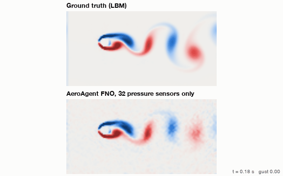
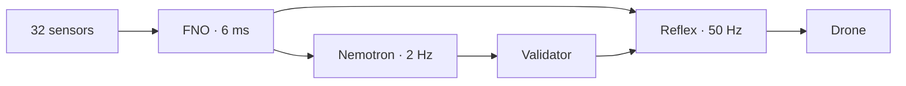
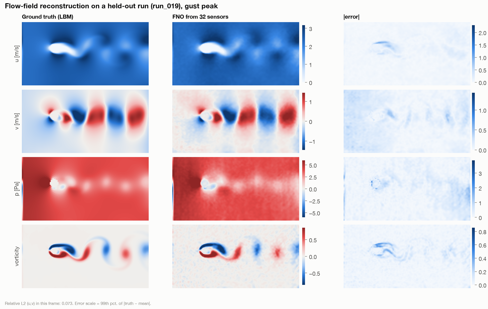
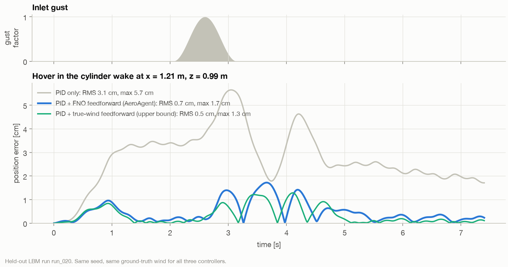
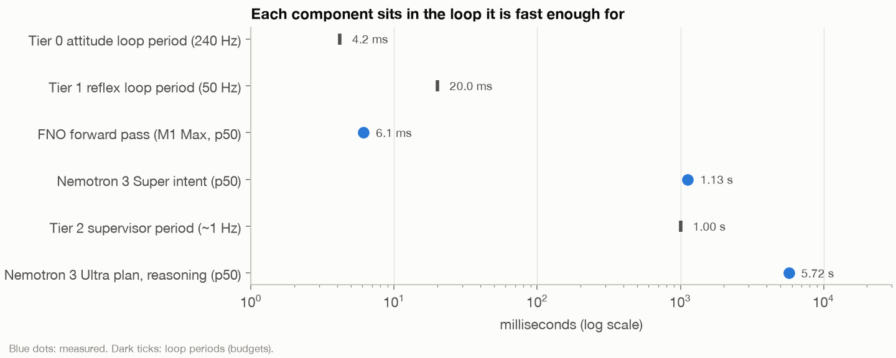

<div align="center">

# AeroAgent

**A drone that sees the air.**

Sparse pressure sensors → neural flow field in 6 ms → a Nemotron-supervised drone that rides the gust.




<sub>Top: simulated airflow. Bottom: what AeroAgent reconstructs from 32 pressure sensors alone.</sub>

[Demo video](docs/media/aeroagent_demo.mp4) · [Results](#results) · [How it works](#how-it-works) · [Quickstart](#quickstart)

</div>

---

## Why

Gusts and wake vortices near buildings, bridges and ships push small drones off course. A CFD simulation could warn them, but it takes minutes. A drone has milliseconds.

## How it works

Three layers, each running only as fast as it can be trusted.

| | Rate | What | Role |
|---|---|---|---|
| **Reflex** | 50 Hz | Fourier Neural Operator → wind at the drone → feedforward | lean into the gust before it hits |
| **Control** | 240 Hz | PID | keep the drone stable |
| **Judgment** | 2 Hz | NVIDIA Nemotron on Nebius Token Factory | decide how to fly it, and explain why |

The language model never touches the motors. Every decision passes a deterministic validator; if the model is late or wrong, the drone simply holds.



## Results

<sub>Simulation, on runs the model never saw. Apple M1 Max.</sub>

<table>
<tr>
<td width="50%"></td>
<td width="50%"></td>
</tr>
<tr>
<td align="center"><sub>Full flow field from 32 sensors, in 6 ms</sub></td>
<td align="center"><sub>Hover error: PID only vs. AeroAgent</sub></td>
</tr>
</table>

| | |
|---|---|
| **−82 %** | hover error vs. PID alone (−77 to −87 % across 4 unseen runs) |
| **6 ms** | flow-field reconstruction (6.3 M-parameter FNO) |
| **0.6 s** | Nemotron decision latency, 37 / 37 valid |
| **0 %** | performance lost when the language model fails completely |

<details>
<summary><b>Full results</b></summary>

<br>

**Reflex (Tier 1), 4 held-out runs**

| Run | PID only | AeroAgent | Reduction | Perfect wind knowledge |
|---|---|---|---|---|
| 019 | 3.2 cm | 0.4 cm | −87 % | −91 % |
| 020 | 3.1 cm | 0.7 cm | −79 % | −84 % |
| 039 | 3.3 cm | 0.8 cm | −77 % | −87 % |
| 040 | 3.5 cm | 0.5 cm | −86 % | −90 % |

A feedforward with the exact mean wind alone (no FNO) already removes 60–76 %. The FNO's value is in the gust, where it cuts the remaining error by another 57–79 %.

**Robustness (run 020)**

| Perturbation | Reduction vs. PID |
|---|---|
| nominal | −79 % |
| drag model ±30 % wrong | −65 / −62 % |
| sensor noise 20 % | −80 % |
| 100 ms delay | −73 % |

**Closed loop with Nemotron (real time, 3 repeats)**

| | RMS | max |
|---|---|---|
| PID only | 3.10 cm | 5.65 cm |
| + FNO reflex | 0.66 cm | 1.72 cm |
| + rule supervisor | 0.54 cm | 1.26 cm |
| + Nemotron 3.5 Lightning | 0.60 ± 0.03 cm | 1.57 ± 0.16 cm |
| + Nemotron with rule guardrail | <!-- TODO --> | <!-- TODO --> |

> *"Gust at drone (0.25) still present for 0.28 s; keep stiff gains."* — Nemotron, live

A zero-latency rule still edges out the LLM on this narrow task, so the rules stay as an instant guardrail and Nemotron adds judgment on top.

**FNO accuracy:** relative L2 error u 0.067 · v 0.343 · p 0.201 on 4 held-out runs.

</details>

<p align="center"></p>
<p align="center"><sub>Each component sits in the loop it is fast enough for.</sub></p>

## Built with

| | |
|---|---|
| **NVIDIA Nemotron 3.5 Lightning** | real-time supervisor, strict JSON schema |
| **NVIDIA Nemotron 3 Super · Ultra** | fallback supervisor · mission planning |
| **Nebius Token Factory** | serves every Nemotron call |
| **Nebius Serverless** | FNO endpoint and training jobs <!-- TODO: status --> |
| **PyTorch · gym-pybullet-drones** | model and flight simulation |

## Quickstart

```bash
conda create -n aeroagent python=3.12 -y && conda activate aeroagent
conda install -c conda-forge pybullet pytorch ffmpeg -y
pip install -r requirements.txt
```

```bash
python -m jobs.generate_lbm --runs 41     # synthetic airflow data
python -m model.train                     # train the FNO
python -m eval.ablation                   # reflex vs. PID
python -m eval.closed_loop --period 0.5   # full loop with Nemotron (needs NEBIUS_API_KEY in .env)
```

<details>
<summary><b>Project layout</b></summary>

```
agent/    Nemotron supervisor, prompt, validator
control/  reflex: FNO wind estimate + feedforward
model/    Fourier Neural Operator, training
sim/      drone simulation, Lattice-Boltzmann solver
eval/     ablation, robustness, closed loop
viz/      figures and video
```

</details>

## Limitations

Simulation only, 2D, one obstacle shape. Sensors sit on the obstacle, not the drone. Not flight-certified.

**Next:** FNO on Nebius Serverless, 3D flow, a real Crazyflie in front of a fan.

---

<div align="center">
<sub>Apache-2.0 · Built solo for the Nebius × NVIDIA Global AI Hackathon, Physical AI track</sub>
</div>