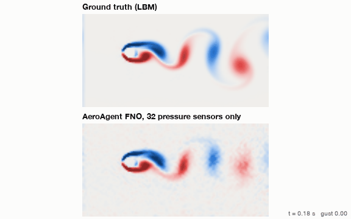
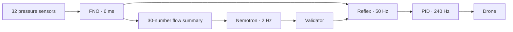
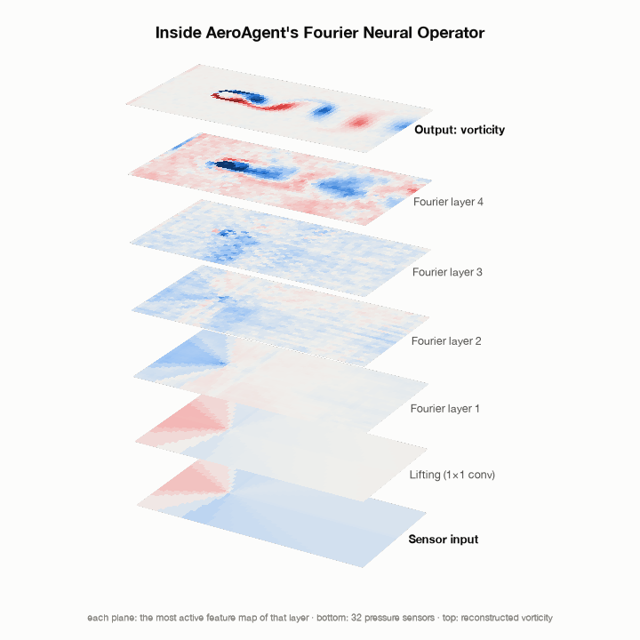
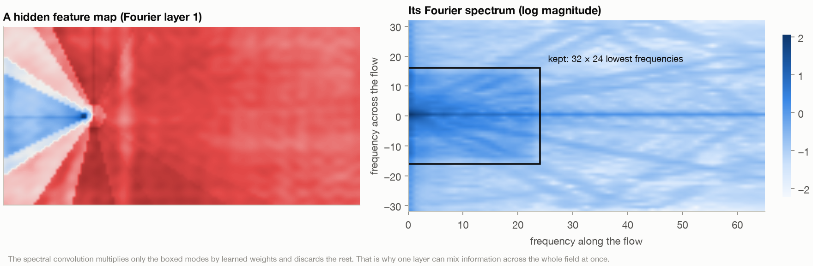
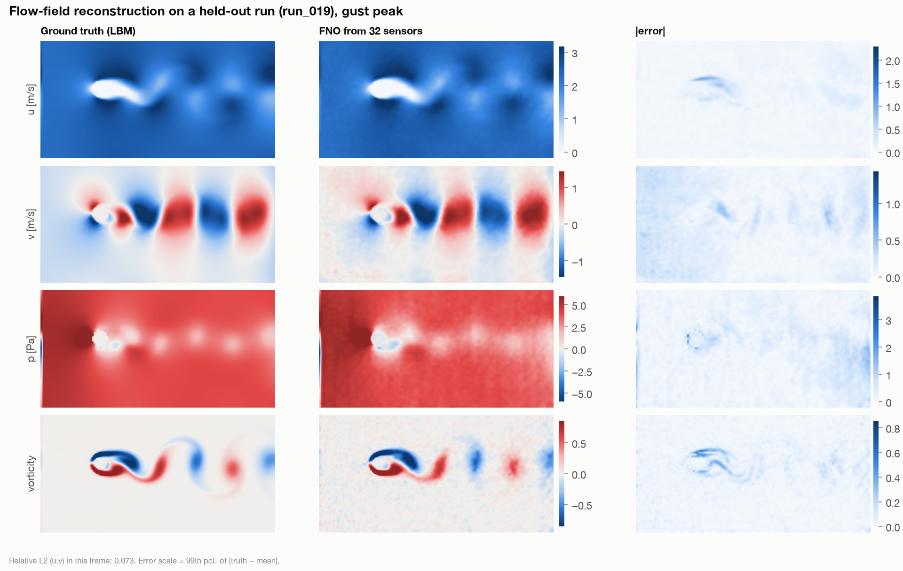
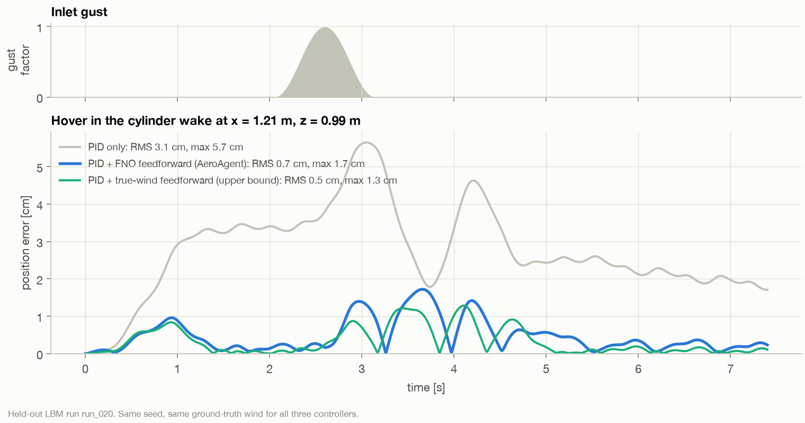
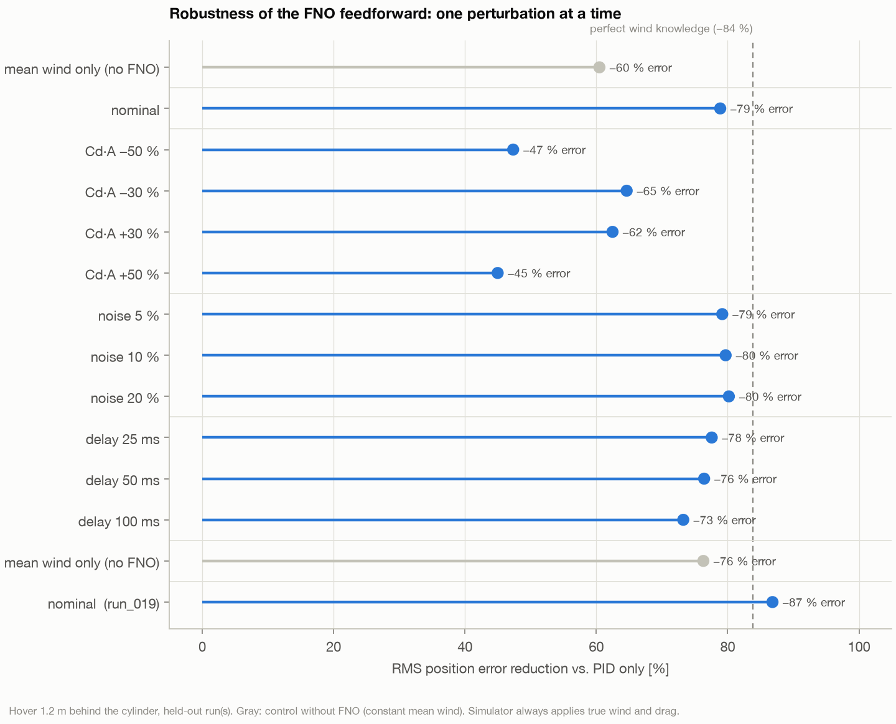
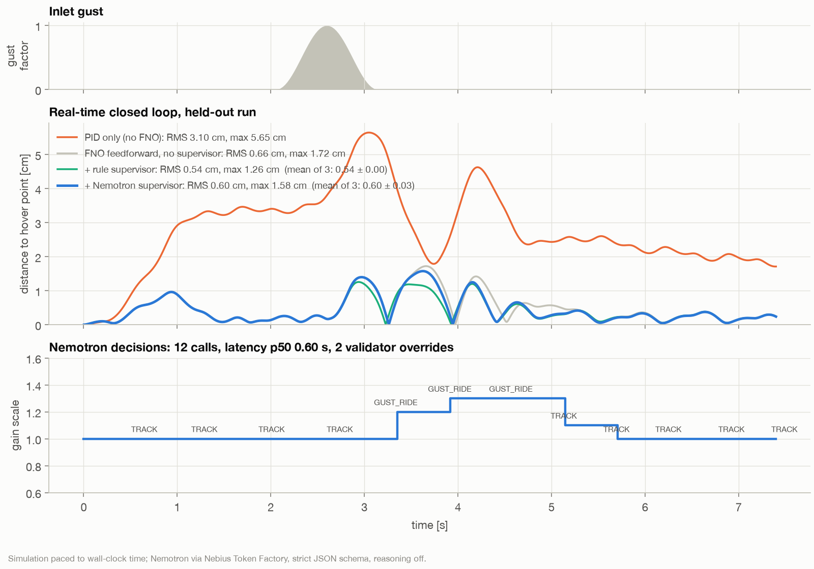
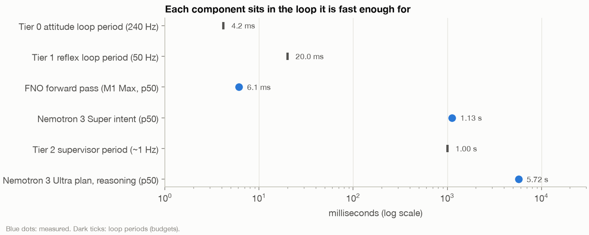

<div align="center">

# AeroAgent

**A drone that sees the air.**

AeroAgent rebuilds the invisible airflow around a drone from 32 pressure sensors in 6 ms,<br>
cancels gusts before they hit, and lets NVIDIA Nemotron decide how to fly them.




<sub>Top: simulated airflow behind an obstacle. Bottom: what AeroAgent reconstructs from 32 pressure sensors alone.</sub>

- [Demo video](https://www.youtube.com/watch?v=MSG6TkUdht0)
- [Features](#features)
- [How it works](#how-it-works)
- [Results](#results)
- [Getting started](#getting-started)
- [Reproduce](#reproduce)

</div>

Gusts and wake vortices near buildings, bridges and ships push small drones off course, and a drone usually notices only after it has been pushed. A CFD simulation could warn it, but takes minutes. A drone has milliseconds.

AeroAgent gives the drone a fast picture of the air around it and a "flight engineer" that decides how to handle it. Everything runs in simulation: a Lattice-Boltzmann solver produces the airflow, [gym-pybullet-drones](https://github.com/utiasDSL/gym-pybullet-drones) flies the drone, and the controller only ever sees the sensors.

> [!NOTE]
> Simulation only, 2D airflow, one obstacle shape. The sensors sit on the obstacle (think instrumented building or ship), not on the drone. Not flight-certified.

## Features

- **Flow reconstruction:** a [Fourier Neural Operator](https://arxiv.org/abs/2010.08895) (FNO) turns 32 noisy pressure readings into a full velocity, pressure and vorticity field in 6 ms.
- **Gust feedforward:** the predicted wind force is fed into the flight controller, following [Neural-Fly](https://arxiv.org/abs/2205.06908), so the drone leans into a gust before it is pushed.
- **LLM supervisor:** [NVIDIA Nemotron](https://build.nvidia.com/nvidia) on [Nebius Token Factory](https://tokenfactory.nebius.com) picks a flight mode about twice per second and explains its choice.
- **Safe by construction:** Nemotron never touches the motors. A deterministic validator clamps and rate-limits every answer, and a late or wrong answer simply leaves the drone holding.
- **Honest evaluation:** held-out airflow runs, a robustness sweep, repeated real-time runs and a mean-wind control experiment.

## How it works

Three layers, each running only as fast as it can be trusted:

| Layer | Rate | What runs | Job |
|---|---|---|---|
| **Control** | 240 Hz | PID controller | keep the drone stable |
| **Reflex** | ~50 Hz | FNO → wind at the drone → feedforward | lean into the gust before it hits |
| **Judgment** | ~2 Hz | Nemotron, in its own process | choose a mode and explain why |



- **The FNO** is a neural network that learned how air flows. It maps sensor history to a full flow field in one forward pass instead of solving the physics step by step. Training adds an incompressibility penalty (∇·u ≈ 0) to the loss.
- **Nemotron** sees about 30 numbers, never the grid, and answers with a small JSON intent (mode, gain, tilt limit, short rationale) under a strict schema.
- **A rule-based guardrail** acts instantly underneath Nemotron, so flight performance does not depend on LLM latency.

<details>
<summary><b>Look inside the network</b></summary>

<p align="center"></p>
<p align="center"><sub>Real activations of each layer while the flow evolves. Bottom: 32 pressure sensors. Top: the reconstructed vorticity.</sub></p>

<p align="center"></p>

</details>

## Results

<sub>Simulation, on airflow runs the model never saw during training. Apple M1 Max.</sub>

<table>
<tr>
<td width="50%"></td>
<td width="50%"></td>
</tr>
<tr>
<td align="center"><sub>Full flow field from 32 sensors, in 6 ms</sub></td>
<td align="center"><sub>Hover error in the wake: PID only vs. AeroAgent</sub></td>
</tr>
</table>

- **−82 %** hover error vs. PID alone (−77 % to −87 % across 4 unseen runs)
- **6 ms** to reconstruct the flow field (6.3 M-parameter FNO, p95 7.3 ms)
- **0.6–0.9 s** per Nemotron decision, 88 of 88 valid across 9 closed-loop runs
- **No loss** in flight performance when the language model is slow or fails

Closed loop in real time, 3 repeats, hover error in the wake:

| Configuration | RMS error | Max error |
|---|---|---|
| PID only | 3.10 cm | 5.65 cm |
| + FNO reflex | 0.66 cm | 1.72 cm |
| + Nemotron 3.5 Lightning | 0.61 ± 0.02 cm | 1.64 ± 0.13 cm |
| **+ Nemotron with rule guardrail** | **0.55 ± 0.00 cm** | **1.29 ± 0.00 cm** |

> [!IMPORTANT]
> The −82 % is measured against plain PID. Compensating only the exact mean wind, with no neural network, already removes 60–76 %. The FNO's value is in the gusts, where it cuts the remaining error by another 57–79 %.

<details>
<summary><b>More results</b></summary>

<br>

**Reflex, 4 held-out runs**

| Run | PID only | AeroAgent | Reduction | With perfect wind knowledge |
|---|---|---|---|---|
| 019 | 3.2 cm | 0.4 cm | −87 % | −91 % |
| 020 | 3.1 cm | 0.7 cm | −79 % | −84 % |
| 039 | 3.3 cm | 0.8 cm | −77 % | −87 % |
| 040 | 3.5 cm | 0.5 cm | −86 % | −90 % |

**Robustness, run 020**

| Perturbation | Reduction vs. PID |
|---|---|
| nominal | −79 % |
| drag model ±30 % wrong | −65 % / −62 % |
| drag model ±50 % wrong | −47 % / −45 % |
| sensor noise 20 % | −80 % |
| 100 ms sensor delay | −73 % |

**FNO accuracy** (relative L2 error, 4 held-out runs): u 0.067 · v 0.343 · p 0.201.





</details>

## Getting started

**Prerequisites:** [conda](https://docs.conda.io/en/latest/miniconda.html), Python 3.12, and for the Nemotron supervisor a [Nebius Token Factory](https://tokenfactory.nebius.com) API key.

> [!IMPORTANT]
> Install PyBullet and PyTorch from conda-forge, not pip. PyBullet's pip build fails on macOS, and a pip PyTorch next to a conda PyBullet loads two OpenMP runtimes (`OMP: Error #15`).

```bash
git clone https://github.com/r00tnomade/aeroagent.git && cd aeroagent
conda create -n aeroagent python=3.12 -y && conda activate aeroagent
conda install -c conda-forge pybullet pytorch ffmpeg -y
git clone https://github.com/utiasDSL/gym-pybullet-drones.git
pip install -e gym-pybullet-drones --no-deps
pip install -r requirements.txt
echo "NEBIUS_API_KEY=your_key" > .env
```

Download [`fno.pt`](https://github.com/r00tnomade/aeroagent/releases/latest) into `checkpoints/`, then run the closed loop with the pre-trained model:

```bash
python -m eval.closed_loop --period 0.5
```

> [!TIP]
> No API key? Compare PID, the FNO reflex and the rule supervisor offline: `python -m eval.closed_loop --policies none rules`.

> [!WARNING]
> `eval.closed_loop` paces the simulation to wall-clock time and calls the Token Factory API, so it spends credits and its result depends on API latency. Latency varies by model, region and time of day: the same model measured 1.1 s and 11 s on one day. Check yours with `python tools/tf_check.py bench --model <id> --constraint strict`.

### Train from scratch

```bash
python -m jobs.generate_lbm --runs 41      # about 1 minute per run, ~60 MB each
python -m model.train                      # holds out runs 019, 020, 039, 040
```

Pass `--arch physicsnemo` to `model.train` to train [NVIDIA PhysicsNeMo](https://github.com/NVIDIA/physicsnemo)'s FNO at a matched configuration instead (`pip install nvidia-physicsnemo`).

## Reproduce

Every number above comes from one of these commands:

| Result | Command | Writes |
|---|---|---|
| Training data | `python -m jobs.generate_lbm --runs 41` | `data/lbm/` |
| FNO accuracy, latency | `python -m model.train` | `checkpoints/metrics.json` |
| Reflex vs. PID | `python -m eval.ablation --run data/lbm/run_019.npz` | `results/ablation_*.json` |
| Robustness | `python -m eval.robustness` | `results/robustness.json` |
| Closed loop | `python -m eval.closed_loop --policies pid none nemotron hybrid --period 0.5 --repeats 3` | `results/closed_loop_*.json` |
| Nemotron latency | `python tools/tf_check.py bench --model <id> --constraint strict` | console |
| Figures | `python -m viz.make_figures` | `docs/figures/` |
| Demo video | `python -m eval.closed_loop --policies pid nemotron --period 0.5` then `python -m viz.make_video` | `docs/media/` |
| 3D network view | `python -m viz.fno_inside` | `docs/figures/` |
| Unit tests | `pytest -q` | console |

## Project structure

```
agent/    Nemotron supervisor, prompt, validator
control/  reflex: FNO wind estimate + feedforward
model/    Fourier Neural Operator, training
sim/      drone simulation, Lattice-Boltzmann airflow solver
jobs/     training-data generation
eval/     ablation, robustness, closed loop
viz/      figures, demo video, 3D network view
tools/    Token Factory benchmark
tests/    validator tests
```

## Related work

AeroAgent builds on the [Fourier Neural Operator](https://arxiv.org/abs/2010.08895) (Li et al.), [sparse-sensor flow reconstruction](https://arxiv.org/abs/2101.00554) (Fukami et al.) and [Neural-Fly](https://arxiv.org/abs/2205.06908) (O'Connell et al.). The fast/slow split follows [NVIDIA GR00T N1](https://arxiv.org/abs/2503.14734). Related code: [neuraloperator](https://github.com/neuraloperator/neuraloperator), [NVIDIA PhysicsNeMo](https://github.com/NVIDIA/physicsnemo), [gym-pybullet-drones](https://github.com/utiasDSL/gym-pybullet-drones).

<div align="center">
<sub>Built solo by <a href="https://github.com/r00tnomade">Sami Adam Moughli</a> for the Nebius × NVIDIA Global AI Hackathon, Physical AI track.</sub>
</div>