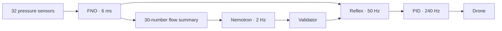
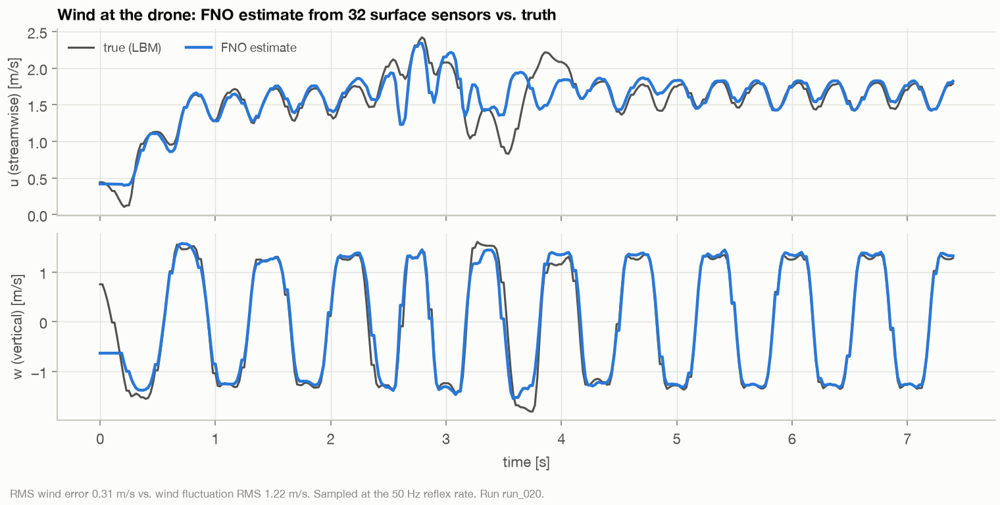
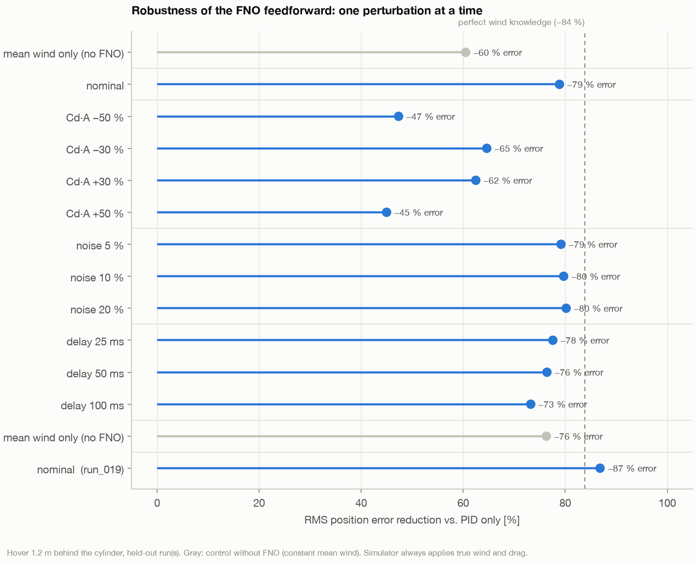
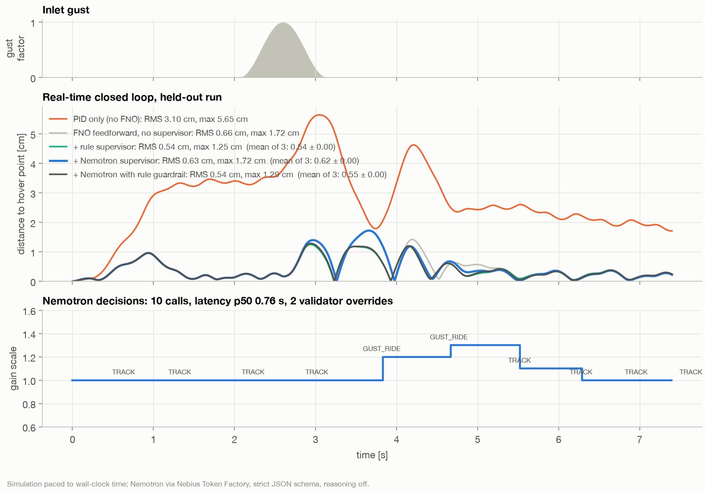

<div align="center">

# AeroAgent

**A drone that sees the air.**

AeroAgent rebuilds the invisible airflow around a drone from 32 pressure sensors in 6 ms,<br>
uses it to cancel gusts before they hit, and lets NVIDIA Nemotron decide how to fly them.


<sub>Top: simulated airflow behind an obstacle. Bottom: what AeroAgent reconstructs from 32 pressure sensors alone.</sub>

[Demo video](docs/media/aeroagent_demo.mp4) · [Results](#results) · [How it works](#how-it-works) · [Quickstart](#quickstart) · [Reproduce](#reproduce)

</div>

---

## Why

Gusts and wake vortices near buildings, bridges and ships push small drones off course. A drone usually notices only after it has been pushed. A CFD simulation could warn it, but takes minutes. A drone has milliseconds.

## How it works

Three layers, each running only as fast as it can be trusted:

| Layer | Rate | What runs | Job |
|---|---|---|---|
| **Reflex** | 50 Hz | [Fourier Neural Operator](https://arxiv.org/abs/2010.08895) (FNO) → wind at the drone → feedforward | lean into the gust before it hits |
| **Control** | 240 Hz | PID controller | keep the drone stable |
| **Judgment** | 2 Hz | [NVIDIA Nemotron](https://build.nvidia.com/nvidia) on [Nebius Token Factory](https://tokenfactory.nebius.com) | decide how to fly it, and explain why |

- **FNO** is a neural network that learned how air flows. It turns 32 sensor readings into a full flow field in one forward pass, instead of solving the physics step by step.
- **Feedforward** means the controller pushes back against the predicted wind instead of waiting to be pushed off course, following the recipe of [Neural-Fly](https://arxiv.org/abs/2205.06908).
- **Nemotron never touches the motors.** It returns a small JSON intent (mode, gain, tilt limit). A deterministic validator clamps it, and if the model is late or wrong, the drone simply holds.



## Results

<sub>Simulation, evaluated on airflow runs the model never saw during training. Apple M1 Max.</sub>

<table>
<tr>
<td width="50%"></td>
<td width="50%"></td>
</tr>
<tr>
<td align="center"><sub>Full flow field from 32 sensors, in 6 ms</sub></td>
<td align="center"><sub>Hover error in the wake: PID only vs. AeroAgent</sub></td>
</tr>
</table>

- **−82 %** hover error vs. PID alone (−77 % to −87 % across 4 unseen runs)
- **6 ms** to reconstruct the flow field (6.3 M-parameter FNO)
- **0.6–0.9 s** per Nemotron decision, 88 of 88 valid across 9 closed-loop runs
- **No loss** in flight performance when the language model is slow or fails completely

<details>
<summary><b>Full results</b></summary>

<br>

**Reflex, 4 held-out runs**

| Run | PID only | AeroAgent | Reduction | With perfect wind knowledge |
|---|---|---|---|---|
| 019 | 3.2 cm | 0.4 cm | −87 % | −91 % |
| 020 | 3.1 cm | 0.7 cm | −79 % | −84 % |
| 039 | 3.3 cm | 0.8 cm | −77 % | −87 % |
| 040 | 3.5 cm | 0.5 cm | −86 % | −90 % |

Compensating only the exact mean wind (no FNO) already removes 60–76 %. The FNO's value is in the gust, where it cuts the remaining error by another 57–79 %.



**Robustness, run 020**

| Perturbation | Reduction vs. PID |
|---|---|
| nominal | −79 % |
| drag model ±30 % wrong | −65 % / −62 % |
| drag model ±50 % wrong | −47 % / −45 % |
| sensor noise 20 % | −80 % |
| 100 ms sensor delay | −73 % |



**Closed loop with Nemotron, real time, 3 repeats**

| Configuration | RMS error | max error |
|---|---|---|
| PID only | 3.10 cm | 5.65 cm |
| + FNO reflex | 0.66 cm | 1.72 cm |
| + rule supervisor | 0.54 cm | 1.26 cm |
| + Nemotron 3.5 Lightning | 0.61 ± 0.02 cm | 1.64 ± 0.13 cm |
| **+ Nemotron with rule guardrail** | **0.55 ± 0.00 cm** | **1.29 ± 0.00 cm** |

<sub>Nemotron: 6 runs over two sessions (latency p50 0.56–0.93 s). Guardrail: 3 runs.</sub>

> *"Gust at drone (0.26) still present for 0.65 s; maintain stiff gains."* (Nemotron, live)

On its own, Nemotron's answer arrives 0.6–1 s after a zero-latency rule would have acted, so it trails the rules slightly and gets worse when the API is slow. With the rules as an instant guardrail underneath, the result no longer depends on LLM latency: in one run Nemotron answered in 1.6 s and missed the gust entirely, and the drone still held 0.55 cm.



**FNO accuracy** (relative L2 error, 4 held-out runs): u 0.067 · v 0.343 · p 0.201.

</details>

<p align="center"></p>
<p align="center"><sub>Each component sits in the loop it is fast enough for.</sub></p>

## Built with

| | |
|---|---|
| **NVIDIA Nemotron 3.5 Lightning** | real-time supervisor, strict JSON schema, reasoning off |
| **NVIDIA Nemotron 3 Super · Ultra** | fallback supervisor · mission planning |
| **Nebius Token Factory** | serves every Nemotron call |
| **Nebius Serverless** | FNO endpoint and training jobs <!-- TODO: status --> |
| **PyTorch** | FNO model and training |
| **[gym-pybullet-drones](https://github.com/utiasDSL/gym-pybullet-drones)** | quadrotor flight simulation |

## Quickstart

```bash
conda create -n aeroagent python=3.12 -y && conda activate aeroagent
conda install -c conda-forge pybullet pytorch ffmpeg -y
git clone https://github.com/utiasDSL/gym-pybullet-drones.git
pip install -e gym-pybullet-drones --no-deps
pip install -r requirements.txt
echo "NEBIUS_API_KEY=your_key" > .env
```

Run the full loop with the pre-trained model:

```bash
python -m eval.closed_loop --period 0.5
```

**Pre-trained weights:** [`fno.pt`](https://github.com/r00tnomade/aeroagent/releases) <!-- TODO: attach to a GitHub release --> goes into `checkpoints/`.

## Reproduce

Every number above comes from one of these commands:

| Result | Command | Writes |
|---|---|---|
| Training data | `python -m jobs.generate_lbm --runs 41` | `data/lbm/` |
| FNO accuracy, latency | `python -m model.train` | `checkpoints/metrics.json` |
| Reflex vs. PID | `python -m eval.ablation --run data/lbm/run_019.npz` | `results/ablation_*.json` |
| Robustness | `python -m eval.robustness` | `results/robustness.json` |
| Closed loop | `python -m eval.closed_loop --period 0.5 --repeats 3` | `results/closed_loop_*.json` |
| Nemotron latency | `python tools/tf_check.py bench --model <id> --constraint strict` | console |
| Figures, video | `python -m viz.make_figures` · `python -m viz.make_video` | `docs/` |

Runs 019, 020, 039 and 040 are fixed as held-out data in `model/train.py`.

<details>
<summary><b>Known issues</b></summary>

- **pybullet fails to build with pip on macOS.** Install it from conda-forge, then install gym-pybullet-drones with `--no-deps`.
- **`OMP: Error #15`, two OpenMP runtimes.** Install PyTorch from conda-forge too, not from pip.
- **Nemotron latency varies by time of day.** The same model measured 1.1 s and 11 s on one day. Run `tools/tf_check.py bench` and pick the fastest model in your region.

</details>

<details>
<summary><b>Project layout</b></summary>

```
agent/    Nemotron supervisor, prompt, validator
control/  reflex: FNO wind estimate + feedforward
model/    Fourier Neural Operator, training
sim/      drone simulation, Lattice-Boltzmann airflow solver
eval/     ablation, robustness, closed loop
viz/      figures and video
tools/    Token Factory benchmark
```

</details>

## Related work

AeroAgent builds on the [Fourier Neural Operator](https://arxiv.org/abs/2010.08895) (Li et al.), [sparse-sensor flow reconstruction](https://arxiv.org/abs/2101.00554) (Fukami et al.) and [Neural-Fly](https://arxiv.org/abs/2205.06908) (O'Connell et al.). The fast/slow split follows [NVIDIA GR00T N1](https://arxiv.org/abs/2503.14734). Related code: [neuraloperator](https://github.com/neuraloperator/neuraloperator), [NVIDIA PhysicsNeMo](https://github.com/NVIDIA/physicsnemo), [gym-pybullet-drones](https://github.com/utiasDSL/gym-pybullet-drones).

## Limitations

Simulation only, 2D airflow, one obstacle shape. The sensors sit on the obstacle (think instrumented building or ship), not on the drone. Not flight-certified.

**Next:** FNO on Nebius Serverless, 3D airflow, a real Crazyflie in front of a fan.

## Citation

```bibtex
@software{aeroagent2026,
  title  = {AeroAgent: neural flow-field feedforward with an LLM supervisor for drones in gusty wakes},
  author = {<Your Name>},
  year   = {2026},
  url    = {https://github.com/r00tnomade/aeroagent}
}
```

---

<div align="center">
<sub>Apache-2.0 · Built solo for the Nebius × NVIDIA Global AI Hackathon, Physical AI track</sub>
</div>